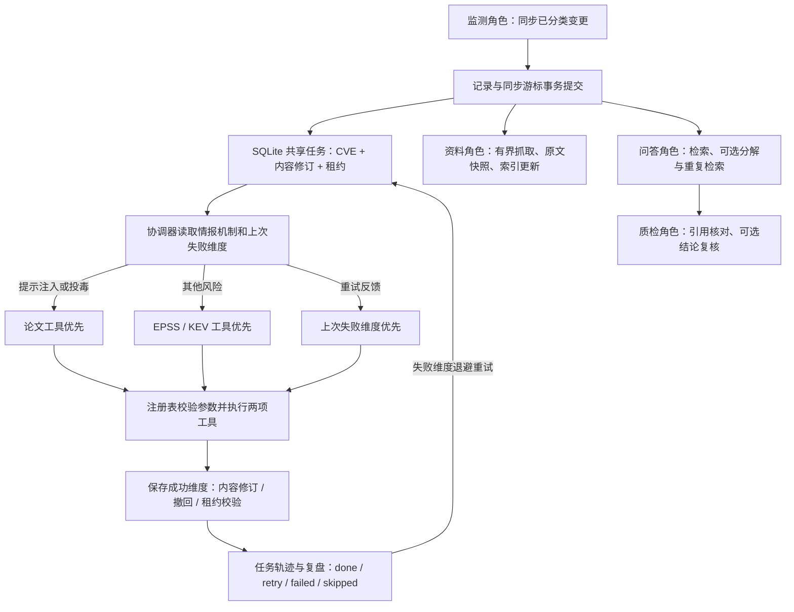

# 智能体编排与工具轨迹

当前系统有监测、富化、问答、引用核对角色，以及负责同步和持久任务的协调器。本轮补充轻量的本地 Planner/Executor 框架：`agents/planning.py` 选择工具优先级，`agents/tool_registry.py` 管理注册、参数及结果校验，`automation/processing.py` 执行并持久化轨迹。它采用规则决策；没有使用 LangGraph、AutoGen 等外部框架，也不把规则优先级称为模型自主规划。



## 能实际核查的行为

- 普通推理服务漏洞先查 EPSS/KEV。明确提及提示注入、数据投毒或模型投毒时先查论文。重试时读取失败维度调整优先级，两项工具均保留。
- 每个工具都有固定注册名、角色、入参和结果校验。未知工具、错误参数和异常结果不能被当作成功调用。注册表不解释 shell 或第三方代码。
- 一个外部工具抛异常时，另一项仍执行。成功信息通过既有事务保存；失败维度进入退避队列。工具内部会分别保留 EPSS/KEV 的状态。
- `processing_jobs.agent_trace_json` 持久保存策略、理由、工具顺序、耗时、错误类型、CVE、内容修订、实际提交事实及复盘。错误只记类型，避免带令牌的 URL 或请求内容泄露。
- `/api/processing/status` 的 `agent_traces` 返回最近 20 项轨迹。被撤回或版本变化的任务标为 `skipped`，不能声称已经提交；已提交但队列终结失败的任务保留实际提交事实。
- 队列是监测、富化、资料与索引角色的共享状态。重启恢复、租约回收、失败重排和旧修订拒绝均沿用现有可靠队列。

可以在正式系统查询：

```bash
curl --fail http://127.0.0.1:8023/api/processing/status
```

离线合成样例默认不启动自动富化，因此查询到空轨迹是正常现象，不能伪造一次真实工具运行。可复现的隔离故障验收：

```bash
python -m unittest questions.test_agent_tools questions.test_processing -v
```

测试覆盖机制决定执行顺序、未知工具拒绝、参数校验、首个工具失败后仍保存论文、并发旧表迁移、撤回拒绝、过期租约不能终结、实际提交后终结失败的轨迹。这些是软件行为证据；不构成真实上游查询成功率、富化准确率或 Agent 相比 pipeline 的质量提升成绩。

## 架构边界与决赛补证

当前持久处理阶段仍是固定的富化、资料、索引阶段。富化阶段的工具顺序是有界规则决策，通用资料推理则可由已配置模型分解最多三个子问题、检索并复核结论。新增工具需要注册与结果持久化适配；新增来源使用 B 的来源目录及适配器，不能声称所有新维度只注册一行即可生效。

短期漏洞问答会话及长期知识/任务已实现；通用资料的完整多轮会话和跨进程会话记忆仍需开发。没有进行真实、独立的 Agent 与固定流程准确率/耗时对比，也没有证明“架构创新且效果显著”。这类结论需要冻结相同输入、来源、模型、预算和人工标签后另做实验。
