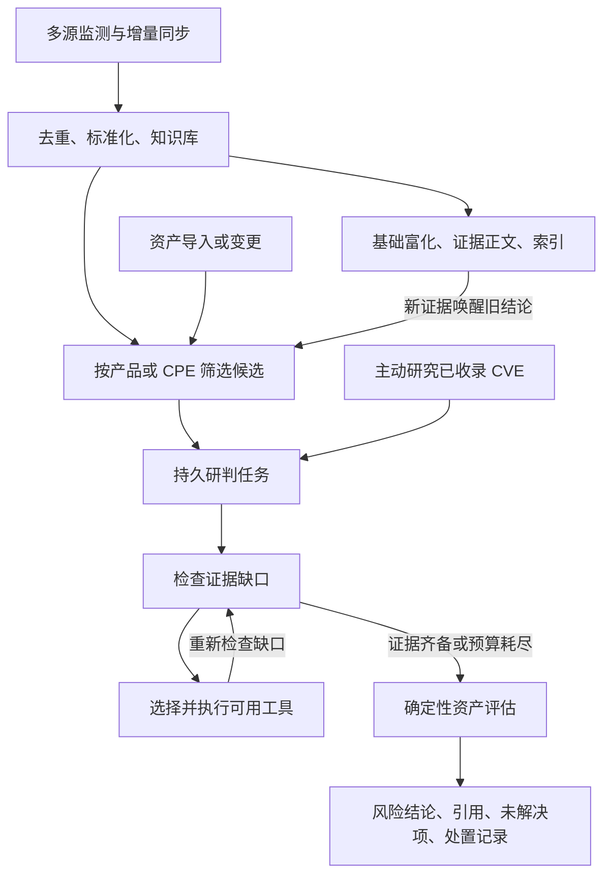

# 智能体编排与工具轨迹

系统保留公共情报持续监测、基础富化、证据归档和检索。新增研判阶段复用同一个 SQLite 持久队列：新情报自动关联登记资产，资产变更自动回查已有情报，用户也可对已收录 CVE 主动创建研究任务。不要求先填写资产才能监测。



## 两种调度边界

基础阶段仍使用 `agents/planning.py` 的有界规则顺序，执行 EPSS/KEV 和论文工具。这条链不依赖模型、资产或新增研判工具。

`agents/investigation.py` 是新增的证据缺口循环。每次执行后重新读取已校验的来源评估，选择尚未尝试且适用于当前缺口的工具：

| 工具 | 实际能力 | 边界 |
| --- | --- | --- |
| `evidence.fetch` | 当前 CVE 的 NVD 记录及已知参考正文 | 不是任意全网搜索；版本结构评估仍主要来自存档 NVD |
| `enrichment.public_feeds` | EPSS 与 KEV 观测 | KEV 不代表发现了可用 PoC |
| `enrichment.papers` | 按 CVE 编号检索论文题名/摘要 | 精确编号范围，不能宣称完整语义召回 |

默认规则选择工具。需要模型参与时，在 `.env.production` 设置 `INVESTIGATION_USE_MODEL=1`，重新创建主应用容器，并在网页模型设置中配置兼容接口。模型只允许返回可用工具名称，不能提交 URL、shell、任意参数、评分或版本。有效选择会进入真实执行；输出非法、超时或无密钥时回退规则。轨迹显示每一步由模型还是规则选择，不能把规则降级称为模型自主决策。

单次研判最多执行三个不同工具，默认工具预算为四次且每工具最多一次；模型最多两次、每次最多 128 个输出 token、共享八秒调用预算。九十秒研判预算用于停止启动新工作；在途网络调用仍受提供者自身超时约束，不是强制中断的墙钟上限。失败由持久队列退避重试，默认最多六次。工具用尽但仍无公开证据时完成本轮并保留缺口，不为了凑齐字段重复调用或编造事实。

## 触发与持久性

- `automation/investigation_queue.py` 使用既有 `processing_jobs`，不另建一套执行器。
- 情报修订和资产清单指纹共同决定重排；仅重复导入时间变化不会重跑。同 CVE 的基础富化/正文先完成一次尝试，失败不会永久阻塞研判。
- 来源修订、撤回、租约过期、资产中途变化均阻止过期结果提交。证据补抓成功会重排研判并失效旧风险；若旧研判正在运行，会撤销旧租约后重新排队。
- 后台每十秒核对队列，以弥补保存与入队之间的进程崩溃。每批最多处理两项研判，现有监测线程不等待工具网络请求。
- 资产研判 worker 由 `AUTO_INGEST_ON_COLLECT=1` 启动，与 `AUTO_MONITOR_ENABLED` 是否开启分离。离线演示关闭自动处理，不把合成样例运行当真实采集证据。
- 索引未准备时记录 `deferred`，BM25 仍可用；每五分钟重试索引就绪检查，不消耗失败重试次数，不再把未建语义索引标为完成。
- `processing_runs` 保留历次有租约的执行轨迹，`asset_risk_history` 保留风险变化和处置记录。

## 资产风险与处置

网页“资产风险”展示当前版本匹配、来源、优先级、待确认项和任务轨迹。影响结论继续由 `enrichment.assets` 的保守规则生成，模型不做版本算术。

候选识别支持精确产品名、已有 NVD/CPE 结构和新抓取证据中解析出的身份。完全缺少可靠组件身份的情报不会自动猜测关联；可主动研究、补充资产标识后再评估。登记资产和平台导出仍不是实时互联网资产发现。

每个资产/CVE 只有一条当前风险记录，历史变化单独保存。资产变化或情报撤回会使旧结论失效；`unknown`、失效和版本命中不能关闭为已解决。只有当前来源明确未命中、引用齐备的结果，才允许用户填写处置依据后关闭。该关闭只证明登记版本与所引用范围不匹配，不证明部署环境已经做过漏洞复现。

研判入口一次接受最多 20 个已收录 CVE，以逗号、空格或换行分隔，自动去重后逐项提交。每个漏洞仍是独立任务，不代表实现了跨漏洞的统一推理。页面逐项显示提交结果，提交未确认的编号保留在输入框中；网络中断时先核对任务列表，再决定是否重试。资产风险和研判任务分别分页，多个任务可以同时展开对照。

## 排队、执行次数与部署排查

“任务执行 0 次”表示当前任务尚未被后台领取；它不表示发现零个漏洞，也不表示模型只推理零次。领取后任务执行次数增加，一次执行可以包含多次 Agent 工具调用。页面分别显示任务执行次数、最新已保存轨迹的工具调用次数和模型调用次数。任务重新排队后计数从零开始，过去执行仍可在“查看历次执行”中查阅；正在执行的轨迹在结束后保存。

页面同时检查自动研判和主动研判线程的实际运行状态，不再仅根据环境开关判断“后台已启用”。任务会显示关闭、未启动、等待同一 CVE 的前置富化/资料抓取、等待重试或等待领取等原因。线程存活只证明执行器仍运行，不保证某个上游请求成功；错误、停止原因和证据缺口需结合任务轨迹查看。

如果显示“后台处理已关闭”，应在**运行该服务的电脑**配置 `AUTO_INGEST_ON_COLLECT=1` 并重启对应服务。不同电脑的 `http://127.0.0.1:8023` 指向各自的实例，修改本机不会影响别人截图中的服务。`INVESTIGATION_USE_MODEL=1` 只控制工具选择是否使用模型，不能替代后台处理开关。

默认 `docker-compose.yml` 与 Dockerfile 为演示用途保留 `AUTO_INGEST_ON_COLLECT=0`；生产 Compose 已开启。若使用默认 Compose，在其 `.env` 中设置 `AUTO_INGEST_ON_COLLECT=1` 后，重新创建主应用容器：

```bash
docker compose up -d --no-deps --force-recreate main-app
```

若启动时使用了其他 `-f` 或 `--env-file`，继续使用原来的文件参数，不要切换成另一套部署。只修改配置文件不会改变已运行进程。直接运行 Python 时，在启动该服务的同一终端设置环境变量再启动；本机打包部署则检查 `runtime.json` 中的同名配置，再使用 `stop.ps1` / `start.ps1` 重启。

## API

| 接口 | 行为 |
| --- | --- |
| `POST /api/assets/import` | 保存清单并返回 `investigations_queued` |
| `GET /api/risks` | 分页风险，可按结论、资产、CVE 筛选 |
| `GET /api/risks/{asset_id}/{cve_id}` | 风险详情与历史 |
| `POST /api/risks/reassess` | 对相关情报重新排队 |
| `POST /api/risks/{asset_id}/{cve_id}/disposition` | 带当前指纹提交处置，拒绝旧页面覆盖新评估 |
| `POST /api/investigations/{cve_id}` | 无资产也可创建 CVE 研究任务 |
| `GET /api/investigations` | 分页任务、总数、真实 worker 状态、等待原因、工具轨迹与停止原因 |
| `GET /api/investigations/{job_id}/runs` | 最近一百次执行记录 |
| `GET /api/processing/status` | 原有全部阶段状态与失败项 |

处置体示例：`{"status":"in_progress","note":"正在核对登记版本","expected_fingerprint":"列表返回的 fingerprint"}`。可用状态为 `pending/in_progress/pending_review/resolved/accepted_risk`。

## 回归与尚未验收的部分

```bash
python scripts/run_offline_tests.py --start-directory questions --pattern 'test_investigation*.py'
python scripts/run_offline_tests.py --start-directory questions --pattern test_risk_register.py
node questions/test_risks_ui.js
```

测试覆盖真实 SQLite 持久化与来源校验，外部工具、模型响应使用受控输入；覆盖有效模型选择、坏输出降级、预算、双向触发、更新与撤回、并发租约、证据更新重排、未知状态不能关闭、页面编辑不被后台刷新覆盖。它们不证明真实上游成功率、付费模型质量或 Agent 相对固定流水线的准确率收益。

当前没有把任意自然语言研究目标转成任意工具图：复杂问答仍使用原有问答流程，主动研究入口以 CVE 为单位。跨漏洞与论文的统一深度任务、完整资料多轮会话、真实互联网资产发现、PoC 隔离复现、独立准确率和持续运行 SLA 仍需继续开发或正式环境验收。
